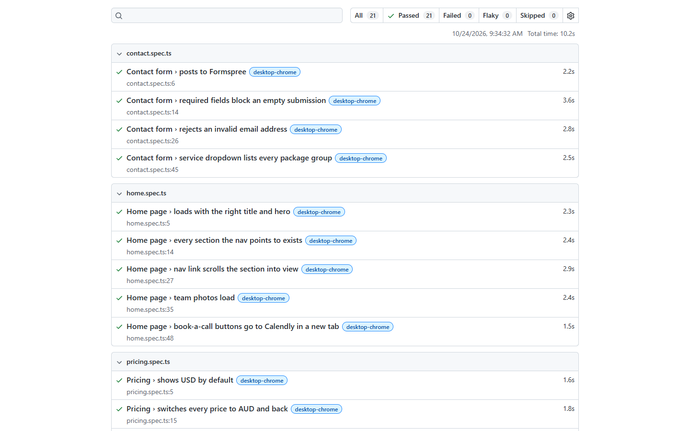

# Qualiteq HQ website: Playwright test suite

End-to-end tests for [qualiteqhq.com](https://qualiteqhq.com), written with [Playwright](https://playwright.dev) and TypeScript.
It shows how I approach test automation for a real, live website: page objects, desktop and mobile coverage, accessibility, performance budgets and CI.

On its first run the suite caught two real bugs on the site (a missing favicon and a request for an image that didn't exist). Both were fixed, and all 21 tests now pass against the live site.



## What's covered

| Area | Checks |
| --- | --- |
| Home page | Title and hero content, every nav link has a target section, smooth scroll, team photos load, Calendly links open safely in a new tab |
| Pricing | USD is the default, every price switches to AUD and back, no price is missing a currency, advertised prices, bundle is cheaper than booking separately |
| Contact form | Posts to Formspree, required fields block empty submissions, invalid email is rejected, service dropdown is complete (the form is never submitted) |
| Mobile | No horizontal scroll, hamburger menu opens, navigates and closes |
| Quality | No serious or critical WCAG 2 A/AA issues (axe-core), no console errors, load-time budget, same-site assets return 200 |

## Project structure

```
pages/HomePage.ts          page object: locators and helpers for the site
tests/home.spec.ts         navigation, content, images, outbound links
tests/pricing.spec.ts      currency toggle and pricing rules
tests/contact.spec.ts      form validation without submitting
tests/responsive.spec.ts   mobile layout and menu
tests/quality.spec.ts      accessibility, console errors, performance, assets
tests/screenshots.spec.ts  portfolio screenshots (run on demand)
.github/workflows/         CI: runs on every push and daily against the live site
```

## Run it

```bash
npm install
npm test            # desktop + mobile Chrome against the live site
npm run report      # open the HTML report
```

Locally the tests use your installed Google Chrome, so there is no browser to download. CI installs Playwright's own Chromium.

Test a local copy before deploying by pointing `BASE_URL` at it:

```bash
BASE_URL=http://localhost:8766 npm test
```

Use a different browser with `PW_CHANNEL=msedge`, or Playwright's bundled Chromium with `PW_CHANNEL=chromium` (after `npx playwright install chromium`).

Regenerate the portfolio screenshots with `npm run screenshots`.

## About

Built by Noel Aparece, ISTQB Certified Tester (CTFL) with 13+ years in software QA, co-founder of [Qualiteq HQ](https://qualiteqhq.com).
